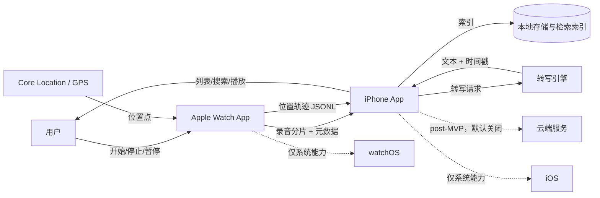
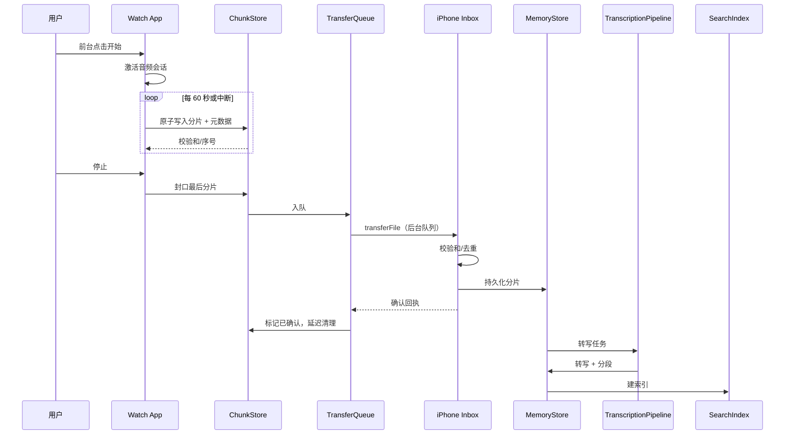
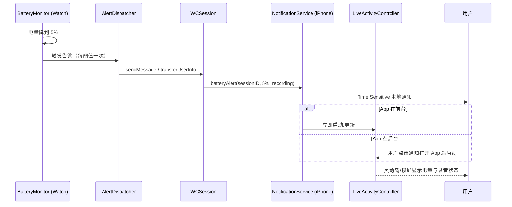
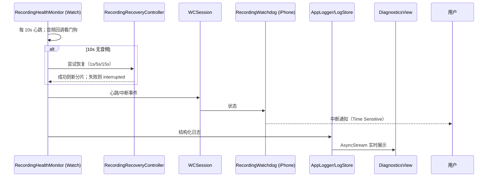
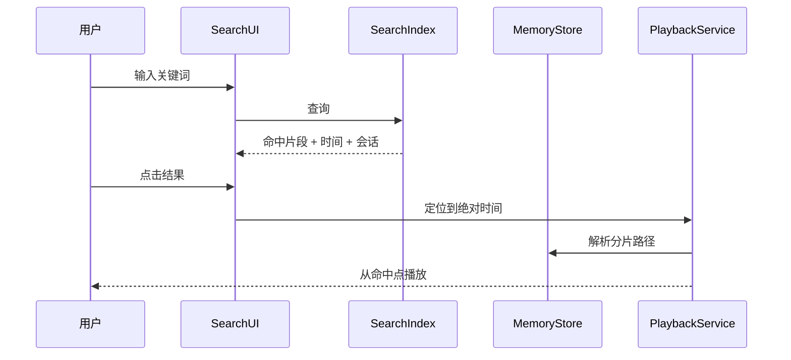

# 系统架构

> 状态：活跃 · 最后更新：2026-10-28

## 系统上下文



MVP 没有自建后端。iPhone 是数据的汇聚点与唯一管理端；Watch 是采集端。云端是否引入由 `Q-002`/`Q-003` 决定。

## 组件

### Watch 端（`AkaMemoWatch`）

| 组件 | 职责 | 不做什么 |
| --- | --- | --- |
| `WatchApp` | 应用入口、场景生命周期 | 不直接操作音频文件 |
| `RecordingCoordinator` | 录音状态机、开始/停止/暂停、中断处理 | 不做转写、不做检索 |
| `AudioCaptureEngine` | `AVAudioSession`/`AVAudioRecorder` 配置、采集、封口 | 不做 UI |
| `ChunkStore` | 分片原子落盘、元数据、崩溃恢复扫描 | 不做传输 |
| `TransferQueue` | 传输队列、重试、确认回执、空间回收 | 不做音频解码 |
| `LocationTrackingService` | 定位授权、采样策略、Core Location 回调 | 不做 GPX 导出、不做录音 |
| `TrackWriter` | 轨迹 JSONL 追加、flush、恢复 | 不做定位、不做 UI |
| `BatteryMonitor` | 读取电量、阈值状态机、低电量降级 | 不做通知、不做传输 |
| `AlertDispatcher` | 通过 WatchConnectivity 发送低电量状态 | 不做本地通知 UI |
| `WatchStatePublisher` | 合并心跳/电量/录音状态为单一 applicationContext | 不做通知、不各自覆盖 context |
| `RecordingHealthMonitor` | 心跳、音频回调看门狗、中断检测 | 不做通知 UI、不做恢复决策 |
| `RecordingRecoveryController` | 自动恢复尝试、缺口记录 | 不在后台静默开麦 |
| `DiagnosticsLogger` | Watch 端结构化日志、批量转发 | 不记录敏感内容 |
| `WatchUI` | 录音状态、定位状态、低电量状态、恢复状态、控制、错误提示 | 不持有业务状态 |

### iPhone 端（`AkaMemo`）

| 组件 | 职责 | 不做什么 |
| --- | --- | --- |
| `PhoneApp` | 应用入口、依赖装配 | 不直接读写音频 |
| `InboxService` | 接收 Watch 分片、校验、去重、入库 | 不做转写 |
| `TranscriptionPipeline` | 转写队列、引擎调用、分段合并、重试；MVP 仅端上 | 不做 UI；MVP 不调用云 |
| `MemoryStore` | SwiftData 持久化：会话/分片/转写/标签 | 不持有音频数据本身 |
| `SearchIndex` | SQLite FTS5 侧车索引、查询、排序、高亮 | 不决定 UI 呈现 |
| `PlaybackService` | 播放、定位、与转写时间轴联动 | 不做转写 |
| `TrackImporter` | 接收轨迹 JSONL、校验、去重、入库 | 不做定位、不做 GPX |
| `GPXExporter` | 从 JSONL 生成 GPX 1.1 | 不上传、不修改轨迹 |
| `NotificationService` | 通知权限、Time Sensitive 本地通知、去重 | 不做 Live Activity UI |
| `LiveActivityController` | 启动/更新/结束低电量 Live Activity | 不直接读 Watch 电量 |
| `RecordingWatchdog` | 监控心跳、判定中断、触发通知 | 不做恢复 UI |
| `IntegrityVerifier` | 校验分片、隔离损坏、重建索引 | 不删除损坏文件 |
| `LogStore` | 环形缓冲、JSONL 轮转、脱敏 | 不上传 |
| `DiagnosticsView` | 实时日志、过滤、导出 | 不直接写日志 |
| `MapView`（P1） | 轨迹展示与时间轴联动 | 不做定位采集 |
| `ManagementUI` | 时间线、搜索、播放、设置、删除 | 不直接碰文件系统 |

### 共享层（`Packages/AkaMemoCore`）

- 模型：`RecordingSession`、`AudioChunk`、`Transcript`、`TranscriptSegment`。
- 协议：存储、检索、转写、传输、时钟、文件系统抽象。
- 工具：音频格式常量、校验和、时间处理、日志分类、错误类型。
- **MUST NOT** 依赖 SwiftUI、UIKit、WatchKit；AVFoundation 仅允许用于纯音频计算，不得依赖播放/录制会话或 UI 相关类型。

依赖方向：

```text
AkaMemoWatch ─┐
              ├──> AkaMemoCore
AkaMemo ──────┘

AkaMemoCore  ──> Foundation / OSLog / AVFoundation（仅音频纯计算，不含播放/录制会话/UI）
```

禁止：`AkaMemo` import `AkaMemoWatch`，或反向 import；共享代码复制两份。

## 数据流

### 录音到入库



### 位置轨迹

位置轨迹与录音并行采集，但不阻塞录音：

1. `LocationTrackingService` 在前台随录音启动，按采样策略把点交给 `TrackWriter`。
2. 会话结束后，轨迹 JSONL 通过 `WCSession.transferFile` 传到 iPhone；长会话可增量传输。
3. `TrackImporter` 校验行数、时间单调性与坐标范围，去重后入库。
4. `GPXExporter` 按需从 JSONL 生成 GPX；不上传。
5. 定位失败只影响轨迹，不影响录音；状态在两端可见。

### 低电量告警



限制：Live Activity 不能从后台启动；系统约 8 小时上限；Critical Alert 需 Apple 批准，MVP 不申请。详见 `../specs/battery-alerting.md`。

### 保活与诊断



### 检索到播放



## 关键设计决定

| 决定 | 理由 | 状态 |
| --- | --- | --- |
| Watch 只采集，iPhone 负责管理与转写 | Watch 算力/电量有限；iPhone 有更大电池与存储 | 已接受（ADR-0003 提议中） |
| 先落盘再传输 | 蓝牙/Wi‑Fi 不可靠；避免内存中丢音频 | 已接受（ADR-0003 提议中） |
| 分片 60 秒 | 断电最多损失 60 秒；文件数约 1440/天可接受 | 已接受（ADR-0007） |
| 本地优先，云端默认关闭 | 录音高度敏感；审核与信任成本 | 已接受（ADR-0002） |
| 共享层独立 Swift Package | 双端共享模型与协议，避免复制 | 已接受（ADR-0001） |
| 存储/检索技术 | SwiftData + SQLite FTS5 侧车索引 | 已接受（ADR-0010） |
| 转写引擎 | MVP 端上；目标混合 | 已接受（ADR-0009） |
| MVP 不上云 | 本地存储；无云转写/后端/iCloud 同步 | 已接受（ADR-0009） |
| 音频参数 | AAC 96 kbps/声道 / 44.1 kHz / 立体声（多声道按硬件） | 已接受（ADR-0011） |
| 最低版本 / 标识 | iOS 18 / watchOS 11；`com.ariakage.AkaMemo` | 已接受（ADR-0012） |
| GPS 本地记录 + GPX 导出 | 用户需求；本地存储、按需导出 | 已接受（G-002 待验证，ADR-0005） |
| 5% 低电量告警 + Live Activity | 24h 续航风险；通知优先、Live Activity 尽力而为 | 已接受（G-003 待验证，ADR-0006） |
| 心跳/看门狗 + 自动恢复 | 发现静默停止；可恢复场景自动续录 | 已接受（G-004 待验证，ADR-0007） |
| 实时诊断日志 | 应用内可观测；默认脱敏 | 已接受（G-005 待验证，ADR-0008） |

## 关键约束

1. **watchOS 后台**：录音只能前台启动，后台只能延续；中断后可在仍持有音频会话时自动重试，平台要求重新前台启动时由用户确认；不得后台无可见状态开麦。详见 `../specs/recording.md`。
2. **Watch 电量与存储**：产品目标为连续 24 小时；G-001 可行性门禁未通过前不得对外承诺；Watch 不能长期保存全部音频。见 `../specs/24h-feasibility.md`。
3. **WatchConnectivity**：文件传输是后台队列，不保证实时与顺序；接收端必须幂等、可重组。
4. **iPhone 后台转写**：受系统后台任务调度限制，不能假设随时可跑；必须持久化队列。
5. **App Store**：持续录音、后台音频、麦克风权限都需要明确用途与用户可见标识。
6. **隐私**：默认本地；任何上传路径都必须可关闭、可审计。
7. **watchOS 定位**：没有可用的 Always 授权；使用 When In Use + 后台定位模式，必须前台启动；后台不能随意停止/重启。详见 `../specs/gps-tracking.md`。
8. **GPS 功耗**：连续定位会显著压缩 24h 续航；G-002 未通过前不得承诺 24h + GPS。
9. **低电量告警**：5% 时通过 WatchConnectivity 触发 iPhone 本地通知；无后端时不保证即时送达。见 `../specs/battery-alerting.md`。
10. **Live Activity**：不能从后台启动；系统约 8 小时上限；不得承诺 24h 常驻或后台自动出现。
11. **Critical Alert**：MVP 不申请；只使用 Time Sensitive，不得称“警报级”。后续如需绕过静音/专注，另写 ADR。
12. **录音完整性**：60 秒物理分片；断电最多损失最后 60 秒；已封口分片损坏目标 0。见 `../specs/recording-health.md`。
13. **自动恢复**：仅在前台/持有音频会话时可自动恢复；不得后台静默开麦；系统指示可见。
14. **诊断日志**：实时、脱敏、7 天/5MB、不上传；不得阻塞音频回调。见 `../specs/diagnostics.md`。
15. **MVP 不上云**：无云转写、自建后端、iCloud/CloudKit 同步；录音/转写/索引由 App 本地处理；系统备份例外见隐私文档。见 ADR-0009。
16. **音频体积**：立体声 96 kbps/声道 / 44.1 kHz 约 86.4 MB/h、2.07 GB/24h；存储、传输、电量按此评估。见 ADR-0011。

## 错误与可观测性

- 每个组件只抛/记录自己负责的错误类型；跨层用统一 `AkaMemoError` 包装，保留底层 `underlying`。
- 日志分类固定：`recording`、`transfer`、`transcription`、`storage`、`location`、`battery`、`ui`、`diagnostics`。
- 关键指标：分片落盘数、传输成功/失败数、转写成功/失败数、索引条数、平均延迟。
- 日志 **MUST NOT** 包含音频内容、转写文本、用户可识别文件名。

## 非目标

- 不自建后端（MVP）。
- 不做云转写、iCloud/CloudKit 同步、账号体系（MVP）。
- 不做多用户/团队/权限体系。
- 不做实时流式转写（MVP 允许分钟级延迟）。
- 不做跨平台（Android/Web）。

## 相关文档

- 数据模型与文件布局：`data-model.md`
- 录音规格：`../specs/recording.md`
- 转写与检索：`../specs/transcription-and-search.md`
- 隐私与安全：`../privacy/privacy-and-security.md`
- 决策与开放问题：`../decisions/README.md`
